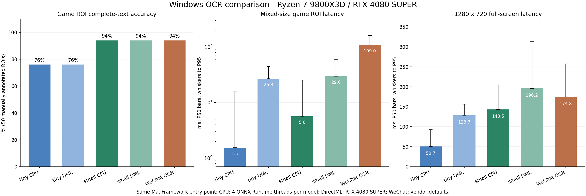

# Windows OCR comparison (2026-11-12)

[简体中文](README.md) · [Back to WeChatOCR-SDK](../../README.en.md)

On these samples, PP-OCRv6 small CPU offers the best balance of accuracy and latency, while tiny CPU is fastest. WeChat and small have the same complete-text ROI accuracy; WeChat hits more annotated full-screen targets but has substantially higher small-ROI latency. DirectML is slower than CPU in this MaaFramework pipeline, including fixed-size verification.



## Environment and samples

- Windows 11 build 26200; Ryzen 7 9800X3D (8 cores / 16 threads); 96 GiB RAM; RTX 4080 SUPER 16 GB, driver 617.42.
- The official [WeChatOCR-SDK v0.2.1 Windows package](https://github.com/MaaXYZ/WeChatOCR-SDK/releases/tag/v0.2.1), WeChat 4.1.15.13 / OCR plugin 8096, with vendor defaults. Its internal compute device was not forced.
- PPOCR uses [MaaCommonAssets `dabcd468` v6 tiny / small ONNX models](https://github.com/MaaXYZ/MaaCommonAssets/tree/dabcd4681ac990dc4361de26416d986abd80e4aa/OCR/ppocr_v6). CPU configures four threads per model; DirectML explicitly selects DXGI adapter 0, the RTX 4080 SUPER.
- [MaaFramework `2df6f033`](https://github.com/MaaXYZ/MaaFramework/commit/2df6f033aa4dd45ff1f2ec292a18ebc2b8eebc8f); ONNX Runtime 1.29.0; DirectML 1.15.4.
- 50 game ROIs from four screenshots in the `PipelineSmoking` and `hbr_battle` test resources; 16 known text strings rendered in clean, small-text and blurred conditions, totaling 48 images; four additional blank images. Full-screen latency uses five 1280×720 screenshots.

Manual transcription, crops and generated samples were frozen before model inference. Generated variants are not independent scenes. These limited samples do not establish a general OCR ranking.

## Accuracy

Every engine performs detection and recognition with `threshold=0`, without `expected` or `replace` filters. Fragmented boxes are joined using the same spatial reading-order rule. Unicode NFKC normalization removes whitespace but preserves case, punctuation and character differences. A sample counts as correct only when the complete text matches. CER is character edit distance divided by the reference character count; lower is better. Engine confidence is not used as accuracy.

| Configuration | Complete-text matches (98) | Correct game ROIs | CER ↓ | Full-screen annotated-target hits |
| --- | ---: | ---: | ---: | ---: |
| v6 tiny CPU | 72/98 (73.47%) | 38/50 | 11.514% | 32/50 |
| v6 tiny DirectML | 72/98 (73.47%) | 38/50 | 11.514% | 32/50 |
| v6 small CPU | 92/98 (93.88%) | 47/50 | 1.752% | 41/50 |
| v6 small DirectML | 92/98 (93.88%) | 47/50 | 1.752% | 41/50 |
| WeChat OCR | 92/98 (93.88%) | 47/50 | 1.877% | 44/50 |

CPU and DirectML text outputs match. All configurations return no text on the four blank images. Tiny more often drops characters or confuses small and traditional Chinese text. Small and WeChat still misread artistic type and confusable strings such as `O0I1l`; individual outputs are retained in the data below.

Full-screen hits concern only the 50 annotated targets: a predicted box must cover at least 25% of the target box, and the associated text must contain the expected string. This is not complete full-screen precision/recall or an ICDAR detection score.

## Latency and startup

All calls use `Tasker.post_recognition(...).wait().get()`, including detection, recognition, framework overhead and result retrieval. Images are predecoded in memory and ROIs are pre-cropped. Configurations run serially in separate processes. Each game ROI is timed five times in shuffled order, totaling 250 calls; each full screenshot has a warm-up followed by 15 timed calls, totaling 75 calls.

| Configuration | Game ROI P50 / P95 | Full-screen P50 / P95 | Process startup P50 |
| --- | ---: | ---: | ---: |
| v6 tiny CPU | 1.534 / 15.499 ms | 50.748 / 92.420 ms | 185.230 ms |
| v6 tiny DirectML | 26.802 / 44.411 ms | 128.705 / 156.548 ms | 658.239 ms |
| v6 small CPU | 5.645 / 25.203 ms | 143.473 / 204.671 ms | 263.813 ms |
| v6 small DirectML | 29.614 / 59.202 ms | 196.171 / 312.807 ms | 787.480 ms |
| WeChat OCR | 108.977 / 161.045 ms | 174.778 / 257.429 ms | 650.399 ms |

Warmed timings exclude initial model loading and each screenshot's first call. Startup is the median of five fresh processes, from Resource creation through the first ROI result. File and driver caches remain in their natural state; the machine was not restarted and OS caches were not cleared.

### DirectML fixed-size verification

DXGI enumeration, DML provider logs and NVIDIA process records confirm that the RTX 4080 SUPER was selected. Each fixed input is warmed and then repeated 40 times; the table reports P50. No backend tuning was performed, and these results do not describe every PaddleOCR backend or GPU.

| Configuration | Same game ROI | Same generated text ROI | Same HBR full screenshot |
| --- | ---: | ---: | ---: |
| v6 tiny CPU | 1.478 ms | 1.507 ms | 54.772 ms |
| v6 tiny DirectML | 2.963 ms | 15.405 ms | 89.324 ms |
| v6 small CPU | 4.095 ms | 4.166 ms | 180.428 ms |
| v6 small DirectML | 4.501 ms | 15.902 ms | 207.866 ms |

## Memory and deployment size

Memory is peak process-tree Windows private commit, including full-screen inference, minus its baseline. It excludes GPU VRAM. WDDM reports VRAM usage as N/A, so no estimate is provided.

| Configuration | Incremental memory |
| --- | ---: |
| v6 tiny CPU | 343.59 MiB |
| v6 tiny DirectML | 820.70 MiB |
| v6 small CPU | 531.49 MiB |
| v6 small DirectML | 1160.58 MiB |
| WeChat OCR | 265.08 MiB |

Models and dictionaries total 5.984 MiB for tiny and 29.673 MiB for small. The local WeChat OCR plugin directory is 49.492 MiB, and the Windows SDK archive is about 414 KiB. This excludes the WeChat host and other runtime dependencies, so it is not a direct comparison of standalone model sizes.

## Data and reproduction

- [Summary JSON](summary.json): environment, model SHA-256 hashes, grouped metrics, individual errors and full-screen target results.
- [Per-sample HTML](report.html): download and open locally to filter by category or errors.
- [Raw data and script snapshots](evidence.zip): 102 images, frozen annotations, all five configurations, startup and fixed-size records, and Python scripts. Model weights and Tencent programs are not included.

Frozen manifest SHA-256: `600b7b03913f58dd2ef498a85390d57f0429696649c9801a43c6d5e5b6b29589`. Inputs and measured values are unchanged. The public archive only redacts the local user-profile directory in diagnostic records and adds environment variables for script paths.

Reproduction requires Windows, Python, `numpy` / `Pillow` / `psutil`, the matching models and screenshots, and a MaaFramework build with WeChat OCR integration. Extract the evidence archive, place the SDK DLL and worker beside the MaaFramework binaries, then configure paths and run:

```powershell
$env:MAAFW_SOURCE_DIR = 'C:/path/to/MaaFramework'
$env:MAAFW_BINARY_PATH = 'C:/path/to/maafw/bin'
$env:WCO_BENCH_MODELS_DIR = 'C:/path/to/MaaCommonAssets/OCR/ppocr_v6'
python bench.py --engine small --device cpu --repeats 5 --full-repeats 15 --output small-cpu-rerun.json
python bench.py --engine small --device directml --device-id 0 --repeats 5 --full-repeats 15 --output small-directml-rerun.json
python bench.py --engine wechat --repeats 5 --full-repeats 15 --output wechat-rerun.json
```

Use `--engine tiny` for tiny. Run `dxgi.py` to check adapter indices on another machine. Report-generation scripts retain this run's environment and version descriptions; update those descriptions when moving to different hardware.
