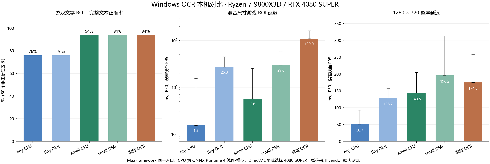

# Windows OCR 对比实测（2026-11-12）

[English](README.en.md) · [返回 WeChatOCR-SDK](../../README.md)

在这批样本上，PP-OCRv6 small CPU 在准确率与速度之间最均衡，tiny CPU 最快。微信与 small 的 ROI 完整文本正确率相同，整屏已标注目标命中略高，但小区域调用明显更慢。当前 MaaFramework 调用链中的 DirectML 延迟高于 CPU，固定尺寸复测也未反转。



## 环境与样本

- Windows 11 build 26200；Ryzen 7 9800X3D（8 核 / 16 线程）；96 GiB RAM；RTX 4080 SUPER 16 GB，驱动 617.42。
- [WeChatOCR-SDK v0.2.1 正式发布包](https://github.com/MaaXYZ/WeChatOCR-SDK/releases/tag/v0.2.1)，微信 4.1.15.13 / OCR 插件 8096，使用 vendor 默认设置，未强制其内部计算设备。
- PPOCR 使用 [MaaCommonAssets `dabcd468` 的 v6 tiny / small ONNX 模型](https://github.com/MaaXYZ/MaaCommonAssets/tree/dabcd4681ac990dc4361de26416d986abd80e4aa/OCR/ppocr_v6)。CPU 每个模型配置 4 线程；DirectML 显式选择 DXGI 0 号 RTX 4080 SUPER。
- [MaaFramework `2df6f033`](https://github.com/MaaXYZ/MaaFramework/commit/2df6f033aa4dd45ff1f2ec292a18ebc2b8eebc8f)；ONNX Runtime 1.29.0；DirectML 1.15.4。
- 50 个真实游戏 ROI，来自 `PipelineSmoking` 和 `hbr_battle` 测试资源中的 4 张截图；16 条已知文字各生成清晰、小字、模糊三个版本，共 48 张；另有 4 张空图。整屏性能使用 5 张 1280×720 截图。

人工转录、裁剪和生成样本均在模型推理前固定。合成变体不是独立场景样本；这些结果不能外推为通用 OCR 排行。

## 准确率

所有引擎均执行检测加识别，`threshold=0`，不设置 `expected` 或 `replace`。统一按空间行顺序拼接碎片框，做 Unicode NFKC 规范化并移除空白，保留大小写、标点和字符区别；整条完全匹配才计正确。CER 为逐字符编辑距离除以标注字符总数，越低越好，未使用引擎置信度代替准确率。

| 方案 | 完整文本正确（98 条） | 游戏 ROI 正确 | CER ↓ | 整屏已标注目标命中 |
| --- | ---: | ---: | ---: | ---: |
| v6 tiny CPU | 72/98（73.47%） | 38/50 | 11.514% | 32/50 |
| v6 tiny DirectML | 72/98（73.47%） | 38/50 | 11.514% | 32/50 |
| v6 small CPU | 92/98（93.88%） | 47/50 | 1.752% | 41/50 |
| v6 small DirectML | 92/98（93.88%） | 47/50 | 1.752% | 41/50 |
| 微信 OCR | 92/98（93.88%） | 47/50 | 1.877% | 44/50 |

CPU 与 DirectML 的文字输出一致。五组配置对 4 张空图均未报文字。tiny 更容易漏字、混淆小字和繁体字；small 与微信仍会误读艺术字体及 `O0I1l` 等易混淆字符，逐条结果保留在下方数据中。

整屏命中只衡量已标注的 50 个目标：识别框覆盖目标框至少 25%，对应文字中包含预期文本即计命中。它不是完整全屏 precision/recall 或 ICDAR 检测分数。

## 延迟与冷启动

同一入口 `Tasker.post_recognition(...).wait().get()`，包含检测、识别、框架调用和结果取回。图像预先解码到内存，ROI 预先裁好；每种配置在独立进程中串行测试，不并行争用设备。游戏 ROI 共计时 250 次（50 个 × 5 轮，打乱顺序）；整屏每张预热后计时 15 次，共 75 次。

| 方案 | 游戏 ROI P50 / P95 | 整屏 P50 / P95 | 进程冷启动 P50 |
| --- | ---: | ---: | ---: |
| v6 tiny CPU | 1.534 / 15.499 ms | 50.748 / 92.420 ms | 185.230 ms |
| v6 tiny DirectML | 26.802 / 44.411 ms | 128.705 / 156.548 ms | 658.239 ms |
| v6 small CPU | 5.645 / 25.203 ms | 143.473 / 204.671 ms | 263.813 ms |
| v6 small DirectML | 29.614 / 59.202 ms | 196.171 / 312.807 ms | 787.480 ms |
| 微信 OCR | 108.977 / 161.045 ms | 174.778 / 257.429 ms | 650.399 ms |

热调用排除首次模型加载及每张整屏的首轮。冷启动为 5 次独立进程中，从创建 Resource 到首个 ROI 返回的中位数；文件与驱动缓存保持系统自然状态，未重启或清空 OS 缓存。

### DirectML 固定尺寸复核

DXGI 枚举、DML provider 日志和 NVIDIA 进程记录均确认测试使用 RTX 4080 SUPER。每个输入预热后连续重复 40 次，下面是 P50；当前调用链未进行后端优化或调参，这也不是其他 PaddleOCR 后端或所有 GPU 的性能结论。

| 方案 | 同一游戏 ROI | 同一合成文字 ROI | 同一 HBR 整屏 |
| --- | ---: | ---: | ---: |
| v6 tiny CPU | 1.478 ms | 1.507 ms | 54.772 ms |
| v6 tiny DirectML | 2.963 ms | 15.405 ms | 89.324 ms |
| v6 small CPU | 4.095 ms | 4.166 ms | 180.428 ms |
| v6 small DirectML | 4.501 ms | 15.902 ms | 207.866 ms |

## 内存与部署大小

内存为包含整屏推理的进程树峰值 Windows private commit 减去基线，不含 GPU VRAM。WDDM 显存查询返回 N/A，因此未估算显存用量。

| 方案 | 内存增量 |
| --- | ---: |
| v6 tiny CPU | 343.59 MiB |
| v6 tiny DirectML | 820.70 MiB |
| v6 small CPU | 531.49 MiB |
| v6 small DirectML | 1160.58 MiB |
| 微信 OCR | 265.08 MiB |

tiny 模型与字典合计 5.984 MiB，small 为 29.673 MiB。本机微信 OCR 插件目录为 49.492 MiB，SDK Windows 压缩包约 414 KiB；未计微信主程序与其他 runtime 依赖，不能直接当作独立模型大小比较。

## 数据与复现

- [汇总 JSON](summary.json)：包含环境、模型 SHA-256、分组指标、逐条错误和整屏目标结果。
- [逐条对比 HTML](report.html)：下载后本地打开，可按类别和错误筛选。
- [原始数据与脚本快照](evidence.zip)：包含 102 张样本、冻结标注、五组完整输出、冷启动记录、固定尺寸记录和 Python 脚本；不含模型权重或腾讯程序。

冻结标注 SHA-256：`600b7b03913f58dd2ef498a85390d57f0429696649c9801a43c6d5e5b6b29589`。样本与数值保持原样，公开证据包只隐去了诊断记录中的本机用户目录，并为运行脚本补充了路径环境变量。

复现需要 Windows、Python、`numpy` / `Pillow` / `psutil`、相同版本的模型与截图，以及包含微信 OCR 接入的 MaaFramework 构建。解压证据包，在 MaaFramework 二进制目录放置 SDK 的 DLL 和 worker 后，配置路径并运行：

```powershell
$env:MAAFW_SOURCE_DIR = 'C:/path/to/MaaFramework'
$env:MAAFW_BINARY_PATH = 'C:/path/to/maafw/bin'
$env:WCO_BENCH_MODELS_DIR = 'C:/path/to/MaaCommonAssets/OCR/ppocr_v6'
python bench.py --engine small --device cpu --repeats 5 --full-repeats 15 --output small-cpu-rerun.json
python bench.py --engine small --device directml --device-id 0 --repeats 5 --full-repeats 15 --output small-directml-rerun.json
python bench.py --engine wechat --repeats 5 --full-repeats 15 --output wechat-rerun.json
```

tiny 使用 `--engine tiny`。其他机器的 DirectML 设备编号可用 `dxgi.py` 核对；生成报告的脚本保留本次环境与版本说明，迁移机器时需相应更新。
